# HomeFix – Home Maintenance Request Management System

HomeFix is a self-initiated portfolio project: a web application for a **fictional** general home maintenance company in Edmonton, Alberta. Customers can browse services and send a service request. Staff review requests, update their status and track progress.

> **Demonstration project.** HomeFix is not a real business or a client commission. All customers, requests and testimonials are sample content.

**Live demo:** https://homefix-t8km.onrender.com
(Free hosting: the first load after inactivity can take about a minute.)
**Demo video:** https://youtu.be/-yUHRZT3Cvk

## Screenshots

### website

<p align="center">
  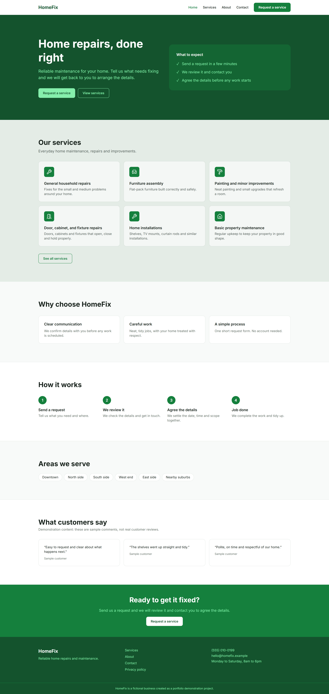
</p>

| Services | Service details |
|---|---|
| 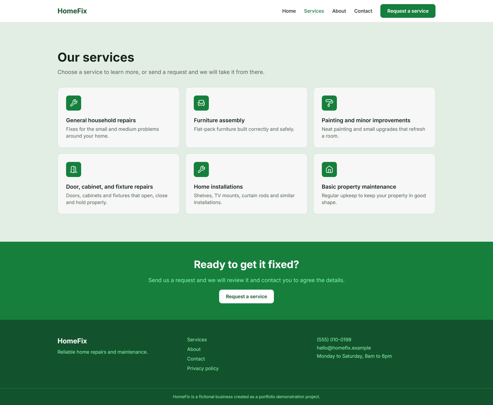 | 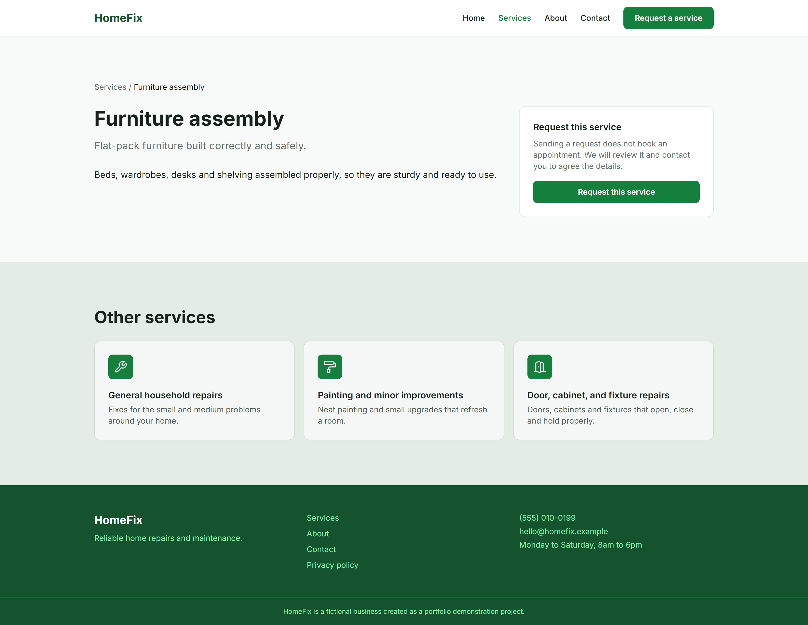 |

| Request form | Request received |
|---|---|
| 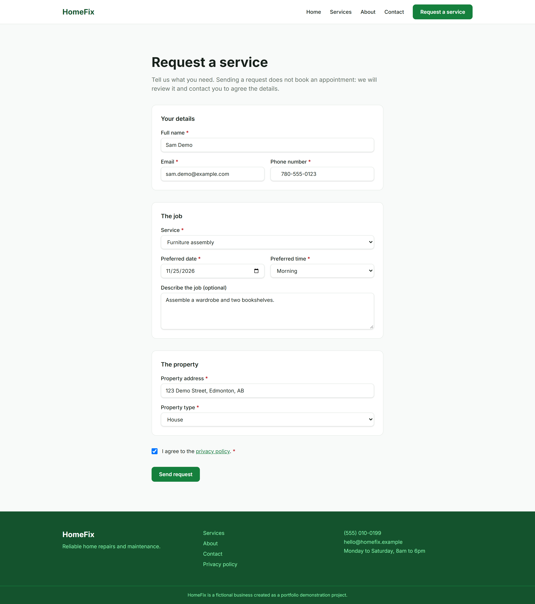 | 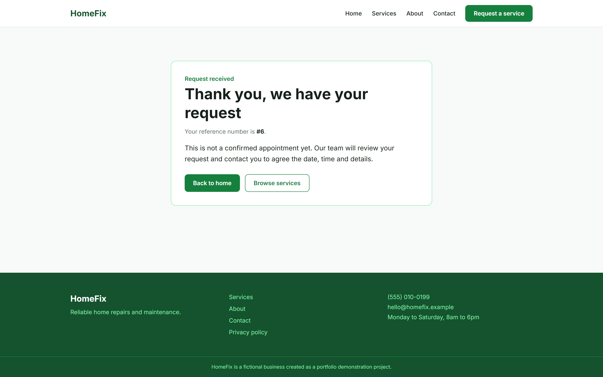 |

### Staff tools

<p align="center">
  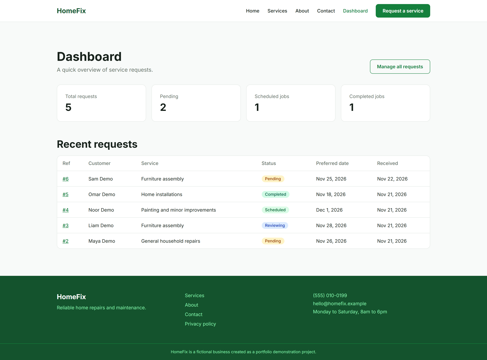
</p>

| Request list | Request details and internal notes |
|---|---|
| 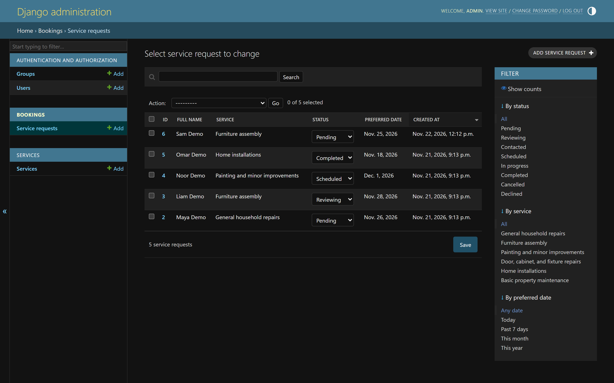 | 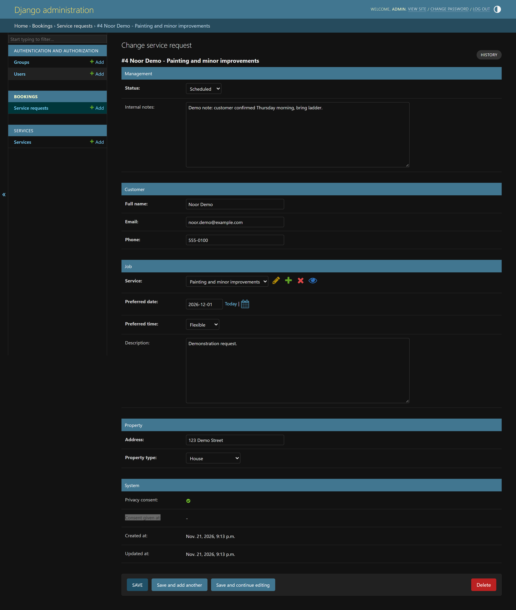 |

### Mobile

<p align="center">
  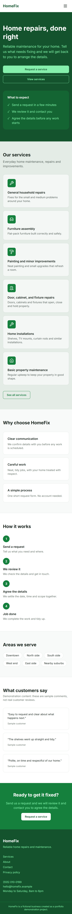
  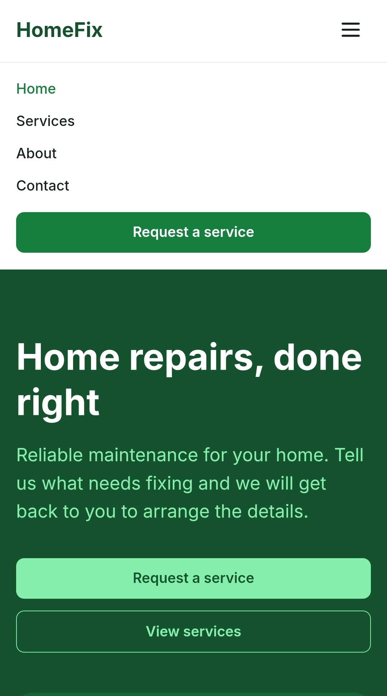
  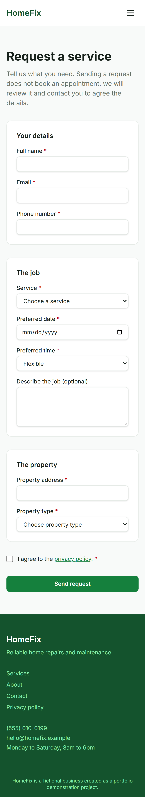
</p>

## Features

**Customer website**
- Responsive pages: home, about, services, service details, contact, privacy policy
- Services are managed in the database and shown dynamically
- Service request form with validation: required fields, phone format, no past dates
- Basic spam and duplicate protection: honeypot field and a 24-hour duplicate check
- Clear confirmation that a request was received, not a booked appointment
- Custom 404 and 500 pages

**Staff tools**
- Staff-only dashboard: total, pending, scheduled and completed requests, plus recent requests
- Request management in Django Admin: search, filters, status updates and internal notes
- Service management: add, edit, reorder, or hide services without deleting them
- Eight request statuses: Pending, Reviewing, Contacted, Scheduled, In progress, Completed, Cancelled, Declined

## How a request works

1. The customer chooses a service and sends a request.
2. The request is saved as **Pending**. No appointment is confirmed.
3. Staff review it and contact the customer.
4. Date, time and scope are agreed separately.
5. Staff update the status as the job progresses.

## Technology

- **Backend:** Python, Django 5.2
- **Frontend:** Django Templates, Tailwind CSS v4, Alpine.js
- **Database:** SQLite (development), PostgreSQL on Neon (production)
- **Hosting:** Render (free instance), WhiteNoise for static files
- **Testing:** Django test framework, 29 automated tests
- **Version control:** Git and GitHub

## Project structure

- `core` – public pages and shared business information
- `services` – maintenance services and the demo-data command
- `bookings` – service requests, form validation and the staff dashboard
- `config` – Django settings and URL configuration
- `templates/` – shared layout and reusable components
- `frontend/input.css` – Tailwind source; the compiled CSS is in `static/css/`

## Local setup (Windows PowerShell)

```powershell
git clone https://github.com/AbdulRahman-AbdulQadir/HomeFix.git
cd HomeFix
python -m venv venv
venv\Scripts\activate
pip install -r requirements.txt
python manage.py migrate
python manage.py seed_demo      # optional demo data
python manage.py createsuperuser
python manage.py runserver
```

Run the tests with `python manage.py test`.

The site is then at http://127.0.0.1:8000/ and the admin at `/admin/`.

`seed_demo` can be run repeatedly without creating duplicates, but it resets the six demo services to their original content each time.

**Optional: rebuild the CSS** after changing templates or `frontend/input.css`, using the standalone Tailwind CLI:

```powershell
tailwindcss -i frontend/input.css -o static/css/styles.css --minify
```

## Configuration

Production settings come from environment variables. No secrets are stored in the repository.

| Variable | Purpose |
|---|---|
| `DJANGO_SECRET_KEY` | Required when debug is off |
| `DJANGO_DEBUG` | `1` for development, `0` in production |
| `DATABASE_URL` | PostgreSQL connection (SQLite is used if unset) |
| `DJANGO_ALLOWED_HOSTS` | Comma-separated hostnames |
| `DJANGO_CSRF_TRUSTED_ORIGINS` | Comma-separated HTTPS origins |

## Deployment

Deployed on Render with a Neon PostgreSQL database. `build.sh` installs dependencies, collects static files and applies migrations. With debug off, Django enforces HTTPS redirects, secure cookies and HSTS.

## Known limitations

- The free Render instance sleeps when idle, so the first request can be slow.
- Request management uses Django Admin instead of a custom interface.
- No email notifications, online payments or customer accounts (out of scope for the MVP).

## What I learned

- Planning a project and doing that step by step.
- Trying to fit like real bussiness needs.
- Preparing a Django project for production: environment variables, PostgreSQL, static files and security settings.
- Using AI tools like Claude, ChatGPT, and Gemini.

## Project purpose

HomeFix was created for learning, practical development experience and portfolio presentation. It is not a real client project or an operating company.
